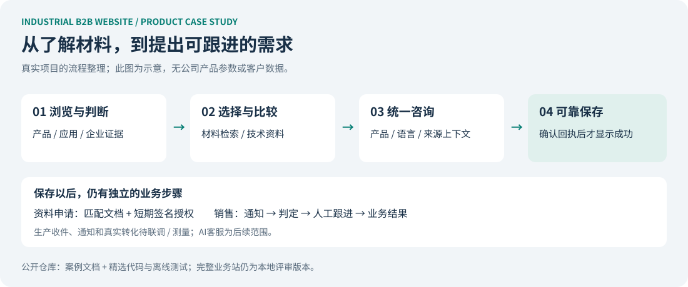

# Industrial B2B Website · 工业品海外获客站

**从买方任务、产品资料与企业可信度，到询盘收件和销售承接的产品设计案例。**

作者：Zegang Cui。参与业务需求梳理、范围和优先级决策、资料审核与多轮评审，借助 AI 工具推进实现。此仓库整理真实本地项目的案例与部分核心代码，公开整理于 2026-10-15。



## 60 秒了解

| 维度 | 项目情况 |
| --- | --- |
| 场景 | 工业材料企业需要承接社媒、搜索与销售分享流量，帮助海外买方了解产品并咨询 |
| 主要用户 | 经销商 / 进口商优先，同时支持工厂采购和技术选型任务；具体画像仍需真实访谈验证 |
| 已有本地实现 | 中英葡三语页面、产品检索/筛选、两款主推资料对比、企业与技术内容、统一询盘及TDS申请 |
| 关键决策 | 多入口共用一个表单；可靠保存才报告提交成功；先人工承接，后续再评估AI客服与CRM |
| 历史验收规模 | v0.17 记录三语共171个内容页、17个产品族；这是模板与内容规模 |
| 当前业务阶段 | 本地可评审，未部署；生产收件与销售通知尚待联调，无上线获客效果结论 |

## 阅读顺序

1. [项目案例](docs/case-study.md)：问题、范围、设计取舍与复盘。
2. [精简PRD](docs/prd.md)：买方任务、流程、异常与验收。
3. [指标与上线边界](docs/measurement-and-launch.md)：什么算收件、有效线索和业务结果。
4. [公开代码范围](docs/implementation-scope.md)：哪些来自原实现，哪些是演示适配。
5. [三分钟讲解](docs/walkthrough.md)：如何展示并解释这一案例。

## 本仓库实际能运行什么

使用 Node.js 22.6 或更高版本，无第三方依赖，无需安装包：

```sh
npm run demo
npm test
```

演示用虚构买方和内存模拟接收端，依次验证：

| 接收情况 | 是否提示成功 |
| --- | --- |
| 未配置接收服务 | 否，并且不调用接收端 |
| HTTP 200，但没有匹配的保存回执 | 否 |
| 回执为 stored=true，且提交ID一致 | 是；这里只是模拟回执，不发送邮件或真实写入销售系统 |

代码还包含TDS短期签名授权、本地验收幂等保存及生产环境禁用本地模式等规则。测试使用临时目录和测试密钥，不提供真实PDF或生产凭证。

**这份公开仓库不启动完整网站。** 完整Next.js业务站仍保留在公司本地项目；这里公开案例与可验证的核心模块，避免把公司素材、参数和留资记录带入源码仓库。实现对应关系见[公开范围说明](docs/implementation-scope.md)。

## 与另一个项目的关系

[外贸客户调查 Agent](https://github.com/ZegangC/b2b-prospect-research)侧重潜在客户发现与证据核验；本项目侧重买方浏览、信任和询盘承接。两者展示同一业务链条上的不同工作，目前没有宣称已自动集成或验证收入归因。

## English overview

A product case study for an industrial B2B lead-generation website, covering buyer journeys, information architecture, multilingual content and reliable inquiry handling. The business site remains a local review build. This repository provides a sanitized retrospective and selected executable rules with synthetic fixtures; it does not claim live traffic, conversion uplift, or an implemented AI chatbot.

## 事实与公开范围

案例根据原项目文档、代码、截图与验收记录整理。历史版本记录不等于当前生产能力；文档生成与测试通过也不代表作者个人能力已经独立评估。公司照片、产品数值与内部型号、技术资料、联系人、留资数据和环境配置均未迁入。本仓库未附开源许可证。
